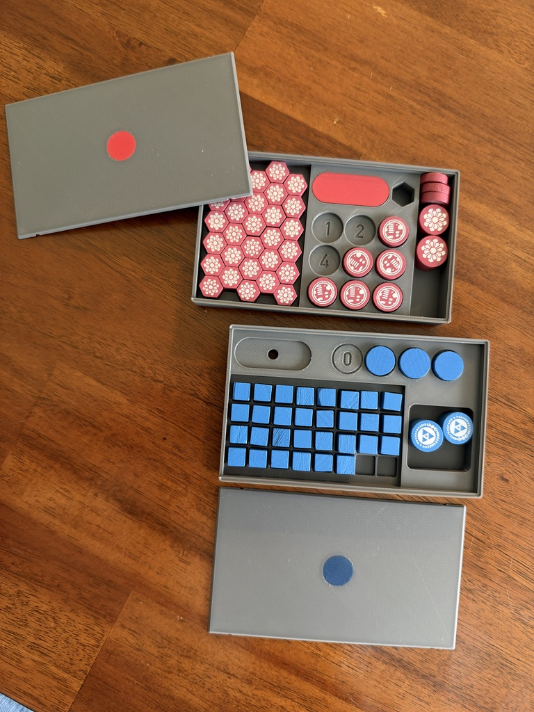

# Fable and 3D Printing

Over the weekend, I decided to have Fable try its hand at creating STL files for a [COIN](https://www.gmtgames.com/c-36-coin-series.aspx) game I'm looking to play. This is a primary use for my 3D printer... upgrading board games with player trays and organizers. Most of the time, I can find these on [BGG](https://boardgamegeek.com/filepage/323758/3dp-insert-for-baltic-empires), but often they're not quite what I'm looking for.

<!-- more -->

So I decided to give Anthropic's greatest new model a go. Here's the [repo](https://github.com/tlofreso/red-dust-rebellion_player-trays/tree/main). The `README` was my prompt. I'm quite happy with the results.

